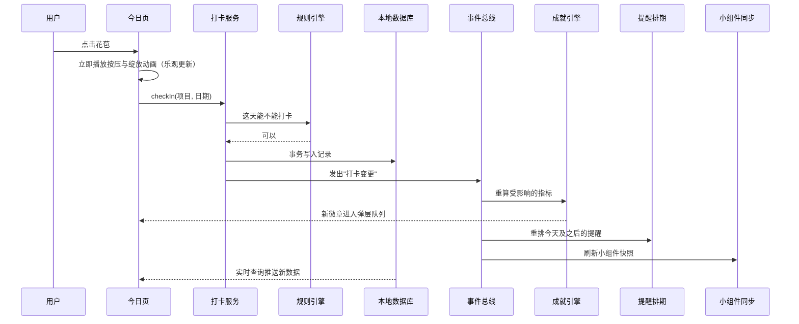

# 01 · 技术方案

> 结论先行：**React Native（Expo，新架构）+ TypeScript**，本地 SQLite 存储，桌面小组件用原生扩展（iOS SwiftUI / Android 组件库），SVG 图标和徽章用 react-native-svg 绘制、用 Reanimated 驱动动画。
> iOS 走 TestFlight 内部测试（或 Ad Hoc）分发，Android 直接发 APK。

---

## 1. 结论摘要

| 项 | 选择 |
|---|---|
| 跨端框架 | Expo（开工时取最新稳定 SDK，新架构默认开启）+ React Native + TypeScript 严格模式 |
| 本地数据 | expo-sqlite + drizzle-orm（类型安全、版本迁移、实时查询） |
| 绘制与动画 | react-native-svg（图标/徽章/插画）+ react-native-reanimated（动画）+ @shopify/react-native-skia（花瓣雨、热力图、图表） |
| 桌面小组件 | iOS：WidgetKit + SwiftUI + AppIntents（iOS 17 起可直接打卡）；Android：react-native-android-widget |
| 提醒 | 本地通知（expo-notifications）+ 自研"滚动窗口"排期 |
| 备份 | 自定义 `.bloom` 文件（zip：JSON + 照片） |
| 分发 | iOS：TestFlight 内部测试（推荐）或 Ad Hoc；Android：签名 APK |
| 系统版本 | iOS 17.0+（仅 iPhone）；Android 8.0+（API 26） |

---

## 2. 技术选型

### 2.1 候选方案对比

评分 1–5，越高越好。权重按本项目实际需要设定。

| 维度（权重） | React Native + Expo | Flutter | 双端原生（Swift + Kotlin） | Kotlin/Compose 多平台 | uni-app |
|---|---|---|---|---|---|
| SVG 绘制与 SVG 动画（高） | 5：react-native-svg 原生支持，可直接对 SVG 元素做动画 | 3：flutter_svg 只能静态渲染，动画需拆成自绘 | 4：各写一套 | 3：需自行解析路径 | 2 |
| 自定义动效与手势（高） | 4：Reanimated + Skia 跑在 UI 线程 | 5：动画体系最成熟 | 5 | 4 | 2 |
| 桌面小组件（高） | 4：两端都需原生，Android 可用 JSX 写组件 | 4：home_widget 成熟，组件界面仍需原生 | 5 | 4：Android 天然，iOS 需 SwiftUI | 1 |
| 本地数据库与迁移（中） | 4：drizzle 类型安全 + 实时查询 | 5：drift 很成熟 | 4 | 3 | 3 |
| 本地通知（中） | 4 | 4 | 5 | 3 | 3 |
| 开发效率（高） | 5：一套代码、热更新开发、TS 生态 | 4 | 2：两套代码，约 1.8 倍工作量 | 3：iOS 生态较新 | 4 |
| 招人和接手（中） | 5：前端即可上手 | 4 | 3 | 2 | 4 |
| 打包分发（中） | 4：本地或 EAS 构建 | 4 | 4 | 3 | 3 |

### 2.2 为什么选 React Native + Expo

1. **SVG 是这个产品的第一公民**。你要求所有图标用 SVG、成就用 SVG 动图。react-native-svg 把 SVG 当成组件渲染，Reanimated 可以直接驱动 SVG 里每个图层的旋转、缩放、透明度、描边进度。这就是"SVG 动画"本身，而不是把 SVG 转成别的格式。Flutter 的 SVG 只能静态显示，做徽章动画要把每个图层拆出来重写成自绘，徽章有 72 枚，工作量差别很大。
2. **动效够用且流畅**。Reanimated 的动画和手势在 UI 线程执行，不受 JS 线程繁忙影响；花瓣雨、彩纸这类粒子效果用 Skia 画，性能接近原生。
3. **小组件两条路都要写原生**，这一点各方案差不多；RN 在 Android 上还能用 JSX 写组件、复用 TS 业务逻辑，略占优。
4. **一套代码、开发快、好接手**，适合内部小团队。

### 2.3 什么情况下改选 Flutter

如果团队主力是 Flutter/Dart 开发者，改选 Flutter 同样可行，需要调整三处：
- 图标：flutter_svg 静态渲染；
- 徽章动画：用 `path_drawing` 解析 SVG 路径，在 CustomPainter 里按图层播放动画（每类底座做一个绘制器）；
- 小组件：用 home_widget 做数据通道，组件界面同样用 SwiftUI / Kotlin 写。

其余设计（数据模型、规则引擎、排期、备份格式、分期）全部不变。

---

## 3. 平台与版本基线

| 项 | 基线 | 理由 |
|---|---|---|
| iOS | 17.0+，仅 iPhone，竖屏 | 17 起小组件可交互（直接打卡），省去低版本分支；iPhone XS 及以后均可升级 |
| Android | 8.0+（API 26），竖屏 | 覆盖内部用户的绝大多数手机 |
| 界面语言 | 简体中文 | — |
| 主题 | 浅色 + 深色（默认跟随系统，可手动切换） | 第 0 期起设计变量就按深浅两套定义，第 4 期实现与走查 |
| 联网 | 不需要。Android 正式包移除网络权限（第 0 期预研确认无副作用） | 用系统权限层面保证"数据不出手机" |

---

## 4. 技术栈清单

| 领域 | 选型 | 用途 |
|---|---|---|
| 框架 | Expo SDK（最新稳定）、React Native 新架构、TypeScript 严格模式 | 基础 |
| 路由 | Expo Router | 文件即路由，模态页、页签、深链（通知点击、小组件点击） |
| 动画 | react-native-reanimated | 所有界面动画 |
| 手势 | react-native-gesture-handler | 日历折叠、拖拽排序、左滑删除、徽章倾斜 |
| 矢量绘制 | react-native-svg | 图标、吉祥物、徽章、花朵 |
| 高性能绘制 | @shopify/react-native-skia | 花瓣雨、彩纸、光芒、热力图、趋势图 |
| 长列表 | @shopify/flash-list | 历史记录、成就馆、心情手账 |
| 底部面板 | @gorhom/bottom-sheet | 频率面板、成绩面板、日期记录面板等 |
| 数据库 | expo-sqlite + drizzle-orm | 存储、迁移、`useLiveQuery` 实时刷新界面 |
| 轻量键值 | react-native-mmkv | 偏好设置、草稿、弹层队列持久化 |
| 状态 | zustand | 界面状态（选中日期、弹层队列） |
| 日期 | date-fns（zh-CN） | 日期运算；业务统一用"YYYY-MM-DD"字符串表示日期 |
| 通知 | expo-notifications | 本地通知、权限、通知点击 |
| 图片 | expo-image、expo-image-picker、expo-image-manipulator | 显示、选择、压缩 |
| 文件 | expo-file-system、expo-document-picker、expo-sharing、react-native-zip-archive | 导出导入、打包 |
| 触感与声音 | expo-haptics、expo-audio | 打卡触感、可选音效 |
| 截图分享 | react-native-view-shot、expo-media-library | 毕业证书、年度花园保存为图片 |
| iOS 小组件 | @bacons/apple-targets（以配置插件方式生成扩展工程）+ SwiftUI + WidgetKit + AppIntents | 小组件 |
| Android 小组件 | react-native-android-widget | 用 JSX 写组件，点击事件在 JS 中处理 |
| 共享存储 | 自研 Expo 模块 `bloom-shared-store`（Swift + Kotlin，约 200 行） | 读写 App Group 共享文件、通知系统刷新小组件 |
| 字体 | expo-font | 圆体标题字、数字字体 |
| SVG 管线 | SVGO + SVGR（脚本） | SVG 优化、生成组件、校验 |
| 测试 | Jest、React Native Testing Library、Maestro | 单元、组件、端到端 |
| 工程质量 | ESLint、Prettier、TypeScript、husky + lint-staged | 提交前检查 |

版本号在第 0 期锁定在 `package.json`，之后只在每期开始时统一升级一次。

---

## 5. 整体架构

### 5.1 分层

```
┌──────────────────────────────────────────────┐
│ 界面层  app/（路由页面） features/（功能组件） ui/（设计系统） │
│          只读数据、只调用服务，不直接写库、不直接调系统能力       │
├──────────────────────────────────────────────┤
│ 服务层  services/   一次用户操作 = 一个服务方法（打卡、撤销、导入…） │
│          负责事务、发事件、编排成就/提醒/小组件                    │
├──────────────────────────────────────────────┤
│ 领域层  domain/     纯 TypeScript：规则、统计、成就、提醒排期       │
│          不碰数据库和系统 API，可在 Node 里单测                     │
├──────────────────────┬───────────────────────┤
│ 数据层  data/         │ 平台层  platform/        │
│ SQLite 仓储、备份格式  │ 通知、小组件、文件、触感  │
└──────────────────────┴───────────────────────┘
```

依赖方向只能从上往下。领域层是整个 App 最重要、最需要测试的部分，规则写错会导致统计全错。

### 5.2 一次打卡的完整链路



- 界面先播动画再等结果（写库通常 < 10ms）。极少数写入失败时，花朵收回，提示"没打上，再试一次"。
- 事件总线是一个类型化的发布订阅，事件只有四类：打卡变更、项目变更、心情变更、整体数据替换（导入后）。

### 5.3 启动与回到前台

`lifecycleService` 负责，每次启动和回到前台执行：
1. 计算逻辑今天；如果跨天，刷新今日页选中日期（若用户停留在"今天"）；
2. 处理"未开始 → 进行中"（派生状态，无需写库）和"到期 → 已毕业"（写库，毕业典礼入队）；
3. 读取小组件写入的待处理打卡队列，逐条入库（按记录 id 去重，可重复执行）；
4. 结算成就（静默结算的合并成一张补发卡）；
5. 重排提醒、刷新小组件快照；
6. 每周一次本地自动快照；检查备份提醒。

---

## 6. 数据模型

所有 id 使用 UUID v7（按时间有序，便于排序和合并）。日期统一 `YYYY-MM-DD` 文本，时间戳统一毫秒整数。

| 表 | 字段（中文说明） | 说明 |
|---|---|---|
| `projects` 项目 | id；name 名称；icon_id 图标；color_id 颜色；motto 鼓励语；unit 单位；start_date 开始日期；end_date 截止日期（空=一直坚持）；duration_preset 时长预设；status 状态（active/paused/graduated）；graduated_on 毕业日期；graduation_seen 是否已播典礼；note_enabled 记录成绩；remind_skip_done 完成后不提醒；remind_skip_period_met 达标后不提醒；sort_order 排序（小数，便于插入）；previous_project_id 上一轮项目；created_at；updated_at | "未开始"由开始日期派生，不存库 |
| `project_rules` 频率版本 | id；project_id；effective_from 生效日期；rule_json 频率规则；created_at | 改频率时新增一行，从不修改旧行 |
| `project_pauses` 暂停区间 | id；project_id；start_date；end_date（空=暂停中） | 用于统计时排除暂停日 |
| `reminders` 提醒 | id；project_id；time 时间（HH:mm）；enabled；created_at | 每个项目 ≤ 5 条 |
| `checkins` 打卡记录 | id；project_id；date 归属日期；checked_at 实际时间；note 成绩备注；source 来源（app/widget/notification）；created_at | 索引：(project_id, date)、(date)、(checked_at) |
| `moods` 心情 | id；date；project_id（空=当天心情）；project_name_snapshot 项目名快照；face 表情；text 文字；created_at；updated_at | 项目删除后靠快照显示名称 |
| `mood_photos` 心情照片 | id；mood_id；file_name；width；height；sort_order | 照片文件存在 App 文档目录 `media/mood/` |
| `achievement_unlocks` 已获徽章 | achievement_id；unlocked_at；context_json（项目、日期）；seen 是否已展示 | 徽章定义在代码里，不存库 |
| `counters` 计数器 | key；value；updated_at | 导出次数、小组件打卡次数、某天撤销次数等成就用的零散计数 |
| `meta` 元信息 | key；value | 数据库版本、首次使用日期 |

偏好设置（昵称、头像、每周起始日、一天结束时间、触感、音效、首页视图、上次备份时间、备份提醒周期、晚间汇总提醒）放在 MMKV，导出时一并打包。

---

## 7. 规则引擎

位置：`src/domain/rule/`。纯函数，输入项目快照（项目 + 频率版本 + 暂停区间 + 相关记录）和日期，输出判断结果。

### 7.1 类型定义（示例）

```ts
/**
 * 打卡频率规则，与需求文档 5.1 的 7 种频率一一对应。
 * 规则一经保存不再修改；改频率会新增一个版本，见 ProjectRuleVersion。
 */
export type FrequencyRule =
  | { kind: 'daily'; timesPerDay: number }                         // 每天，每天 N 次
  | { kind: 'weekdays'; weekdays: Weekday[]; timesPerDay: number } // 每周固定几天
  | { kind: 'weeklyDays'; days: number; timesPerDay: number }      // 每周任选 X 天
  | { kind: 'weeklyTimes'; times: number }                         // 每周累计 X 次
  | { kind: 'monthDates'; dates: number[]; timesPerDay: number }   // 每月固定几号
  | { kind: 'monthlyDays'; days: number; timesPerDay: number }     // 每月任选 X 天
  | { kind: 'monthlyTimes'; times: number };                       // 每月累计 X 次

/** 频率版本：effectiveFrom 当天及之后使用该规则，直到下一个版本生效 */
export interface ProjectRuleVersion {
  effectiveFrom: LocalDate;
  rule: FrequencyRule;
}
```

### 7.2 核心函数

| 函数 | 作用 |
|---|---|
| `ruleOn(versions, date)` | 取某天生效的频率规则 |
| `isVisibleOn(project, date)` | 需求 5.4 的五条判断，返回是否出现及原因 |
| `canCheckIn(project, date, today)` | 返回可以/不可以及原因（未来、开始前、结束后、暂停、非计划日、已满） |
| `dayProgress(project, date, records)` | 当天进度：已完成次数、目标次数、是否完成 |
| `periodProgress(project, date, records)` | 周期进度：周期起止、有效天数、折算后的目标、已完成、是否达标 |
| `streak(project, records, today)` | 当前连续、最长连续、单位（天/周/月） |
| `completionRate(project, records, today)` | 完成率及分子分母 |
| `logicalToday(now, dayEndHour)` | 逻辑今天（夜猫子模式） |

### 7.3 必须覆盖的单测场景（至少 150 个用例）

- 7 种频率 × 当天未打/部分/完成/超额；
- 月末：1 月 31 日、2 月 28/29 日（闰年）、4 月 30 日选 31 号；
- 每周起始日（周一/周日）对"每周任选 X 天"的影响；
- 项目在周中/月中开始、结束、暂停导致的目标折算；
- 频率版本切换当天、切换所在周；
- 暂停跨月、暂停当天继续、今天已打卡后暂停；
- 连续：今天未完成不断、非计划日跳过、暂停日跳过、补卡后连续重算；
- 夜猫子模式：23:59、00:30、02:00 边界；
- 毕业：截止日当天、次日、提前毕业当天的显示与补卡。

---

## 8. 统计计算

- 统计在领域层按需计算，输入是一段时间内的记录（SQL 按日期区间取）。
- 数据量估算：10 个项目 × 每天 3 次 × 3 年 ≈ 3.3 万条，SQLite 区间查询加内存计算可在 200ms 内完成。
- 缓存：以"数据版本号"为键做内存缓存，任何写操作使版本号 +1。不建持久化汇总表，避免数据不一致。
- 统计页首屏只算当前视图（总览/当月/当年），切换时再算。

---

## 9. 成就引擎与徽章渲染

### 9.1 判定

- 徽章定义写在 `src/domain/achievement/definitions.ts`，每条包含：id、系列、等级、名称、条件说明、是否隐藏、指标、阈值、徽章外观（底座、图案、配色、动效）。
- 指标（约 30 个）如：最长按天连续、最长周期连续、累计打卡、记录天数、完美日数、最长完美日连续、7 点前打卡次数、心情篇数、照片数、毕业项目信息、计数器值等。
- 事件 → 受影响指标的映射表决定每次重算哪些指标，避免全量计算。
- 新解锁写入 `achievement_unlocks`（seen = 否），并放入弹层队列；弹窗关闭后置为已展示。App 被杀后未展示的下次启动补弹。
- **静默结算**：首次升级到含成就的版本、导入备份后，结算结果不逐个弹出，合并成一张"补发"卡。

### 9.2 徽章渲染（SVG 动图的实现方式）

每枚徽章 = 底座（按系列，共 12 种）+ 图案（每枚独立）+ 等级配色（4 种）+ 数字（"徽章数字"字形拼接，不用文字）+ 动效预设。

```
<Badge id="streak_7" size={180} motion="celebrate" />
  ├─ 光芒层（可选，等级 3 以上）
  ├─ 底座层（花环/星形/爱心……）
  ├─ 缎带层
  ├─ 图案层
  ├─ 数字层
  ├─ 闪光扫过层（遮罩）
  └─ 星星点缀层
```

- 动效预设（弹入、光芒旋转、闪光扫过、星星闪烁、描边绘制、花瓣展开、彩虹环）用 Reanimated 驱动各图层的变换、透明度、描边进度。
- 三种模式：`celebrate`（弹窗，完整动画）、`idle`（详情页，轻微循环：光芒慢转 + 星星闪）、`static`（成就馆网格，无动画，省性能）。
- 设计稿交付每枚徽章的分层 SVG；研发在开发版"徽章陈列页"逐枚预览动画。

---

## 10. 提醒排期

### 10.1 约束

- iOS 每个 App 最多保留 64 条待发送本地通知；本地通知内容在排期时就定好，发送时无法再改。
- 重复型通知无法"跳过某一天"，所以"完成后当天不再提醒"必须用单次通知实现。

### 10.2 滚动窗口算法

```
重排(现在):
  候选 = []
  对每个"进行中"的项目、每个开启的提醒时间、未来 14 天的每一天：
      若该天是计划日 且 不在暂停 且 在起止范围内：
          若 是今天 且 已完成 且 开启"完成后不提醒" → 跳过
          若 周期已达标 且 开启"达标后不提醒" → 跳过
          加入候选 {发送时间, 项目, 文案}
  加入晚间汇总提醒（今天的文案按当前未完成项目生成；之后的日子用通用文案）
  按发送时间排序，取前 60 条（iOS 留 4 条余量）
  与系统中已排期的通知对比（通知 id = 项目:提醒:日期），删多余、补缺少
```

触发时机：启动、回前台、打卡/撤销、项目增删改、提醒变更、导入完成、跨天。

覆盖不足时（提醒太多，60 条不够覆盖 3 天），"提醒检查"页提示"提醒有点多，记得每两天打开一次 Bloom"。

### 10.3 Android 到达率

- Android 13+ 申请通知权限；12+ 需要精确闹钟：因为不上架 Google Play，可以声明 `USE_EXACT_ALARM`（安装即授予），并保留 `SCHEDULE_EXACT_ALARM` 作为兜底。第 0 期预研确认 expo-notifications 在这两种权限下实际使用精确闹钟，否则补一个原生排期模块。
- 国产系统（小米、华为、荣耀、OPPO、vivo）需要用户手动开启自启动/关闭电池优化。"提醒检查"页识别品牌，给出对应的设置步骤和跳转按钮。

---

## 11. 桌面小组件

### 11.1 数据通道：快照 + 待处理队列

小组件不直接读写主数据库，避免两个进程同时写库：

```
App ──写──▶ 共享目录/widget-snapshot.json   ──读──▶ 小组件显示
小组件 ──追加──▶ 共享目录/widget-queue.json  ──读──▶ App 启动/回前台时入库
```

- iOS 共享目录 = App Group 容器；Android = App 私有目录（小组件与 App 同进程）。
- 快照内容：今天和明天两天的项目列表与进度（明天用于零点翻日）、本月每天的完成分级（大号组件日历用）、昵称、生成时间。
- 小组件点击打卡：生成带 id 的记录追加到队列，同时修改快照里的进度并立即刷新自身显示。
- App 读取队列入库时按 id 去重，可重复执行；入库后清空队列、触发成就结算（徽章在 App 下次打开时弹出）。
- 零点翻日：iOS 时间线在下一个零点（按一天结束时间）放一个条目，用快照里"明天"的数据显示。

快照示例：

```json
{
  "version": 1,
  "generatedAt": 1795372800000,
  "today": "2026-11-22",
  "days": {
    "2026-11-22": [
      { "projectId": "01J…", "name": "喝水", "icon": "health/water-cup", "color": "soda",
        "kind": "daily", "done": 3, "target": 8, "unit": "杯", "canCheckIn": true }
    ],
    "2026-11-23": []
  },
  "monthLevels": { "2026-11-01": 4, "2026-11-02": 2 },
  "nickname": "小桃"
}
```

### 11.2 平台实现

| | iOS | Android |
|---|---|---|
| 界面 | SwiftUI，`targets/widget/` | JSX，`widgets-android/` |
| 打卡 | iOS 17 `Button(intent:)` + AppIntent，写队列、改快照、`reloadTimelines` | 点击事件进入 JS 任务处理器，直接调用打卡服务写库，再刷新组件 |
| 图标 | 构建脚本把项目图标 SVG 复制进扩展的资源目录（保留矢量数据） | 组件内渲染 SVG |
| 刷新 | App 数据变更后调用 `WidgetCenter.reloadAllTimelines()` | 数据变更后调用组件刷新 |
| 已知限制 | 小组件打卡后，当天已排期的提醒可能仍会响一次，直到下次打开 App（第 4 期预研是否可在扩展内取消） | 无 |

---

## 12. 导入导出与数据安全

### 12.1 备份文件格式

```
Bloom备份_20261122_1144.bloom      本质是 zip 压缩包
├── manifest.json                  格式版本、数据库版本、App 版本、导出时间、各类数量、data.json 校验值
├── data.json                      全部表数据 + 偏好设置
└── media/
    └── mood/                      心情照片（文件名即照片 id）
```

```json
{
  "format": "bloom-backup",
  "formatVersion": 1,
  "schemaVersion": 3,
  "appVersion": "1.0.0",
  "exportedAt": "2026-11-22T11:44:00+08:00",
  "platform": "ios",
  "counts": { "projects": 5, "checkins": 268, "moods": 12, "photos": 23, "achievements": 31 },
  "sha256": "…"
}
```

### 12.2 导入步骤

1. 解压到临时目录；
2. 校验格式标识、校验值、格式版本（比 App 新 → 拒绝，提示先升级）；
3. 旧格式逐级升级到当前格式；
4. 显示预览，等用户确认；
5. 把当前数据导出到 `backups/导入前自动备份_时间.bloom`；
6. 在一个数据库事务中清空并写入全部表；
7. 照片先写入新目录，成功后整体替换旧目录；
8. 重排提醒、刷新小组件、静默结算成就；
9. 清理临时文件。任一步失败：事务回滚、删除新目录、提示具体原因（文件损坏 / 版本太新 / 空间不足）。

### 12.3 其他保护

- **数据库迁移前备份**：每次 App 升级需要迁移时，先复制数据库文件（保留最近 2 份），迁移失败自动还原并提示导出诊断日志。
- **本地自动快照**：每周一次，保留 4 份，在"备份与恢复 → 自动快照"中可恢复。注意：卸载 App 会一起删除，所以仍需手动导出。
- **CSV 导出**：打卡记录、项目两张表，UTF-8 带 BOM，Excel 直接打开不乱码。
- **iOS"文件"可见**：开启文件共享，导出的备份在"文件 → 我的 iPhone → Bloom"里能看到。
- **文件关联**：注册 `.bloom` 类型，在微信、文件 App 中点击备份文件可直接用 Bloom 打开进入导入流程（Android 部分来源的文件无法识别类型，保留手动选择入口）。

---

## 13. SVG 资产管线

```
设计稿（Figma） ─导出─▶ assets/svg/**
                         │
              scripts/svg-lint.ts  校验
                         │
              scripts/svg-build.ts
                ├─ SVGO 优化
                ├─ 生成 TSX 组件 → src/ui/icons/（文件头标注"由脚本生成，勿手改"）
                ├─ 生成图标注册表（id、分类、中文名、搜索关键词）
                ├─ 生成灰度版本（暂停/禁用状态用）
                └─ 复制到 iOS 小组件资源目录
```

校验规则（不通过则构建失败）：
- 必须有 `viewBox`，尺寸符合规范：界面图标 24×24、项目图标 64×64、徽章 200×200、插画按画板；
- 禁止 `<text>`、`<image>`、`<foreignObject>`、`<filter>`、`<style>`、外链资源、内嵌位图、CSS 动画；
- 颜色必须来自色板（允许色板颜色的透明度变化）；界面图标的描边必须写成"跟随当前颜色"，以便深色模式自动变色；
- 体积上限：界面图标 2KB、项目图标 6KB、徽章 20KB、插画 40KB。

---

## 14. 动效实现要点

- 所有动画用 Reanimated 在 UI 线程执行；只动 `transform`、`opacity`、SVG 属性，不动布局属性（宽高、边距）。
- 粒子效果（花瓣雨、彩纸）用 Skia 画在全屏透明画布上，同屏 ≤ 60 个粒子，播放完立即卸载画布。
- 日历折叠：一个 0–1 的共享进度值同时驱动日历行高和透明度，绑定列表拖动手势，松手按速度吸附。
- 数字滚动：每位数字独立上下滚动。
- 系统开启"减弱动态效果"时，`ui/motion` 里的所有预设自动换成 160ms 淡入淡出，不播粒子和弹跳。
- SVG 图层动画：react-native-svg 只在 JS 侧把 `transform` 换算成原生 `matrix`，Reanimated 在 UI 线程更新属性时不经过这一步。所以图层用 `ui/motion/svg` 的 `AnimatedG`，在 worklet 里用 `partMatrix(originX, originY, { rotate, scale, translateX, … })` 算好 `matrix` 再交给它。
- 待机循环统一由 `ui/motion/idle` 的 `useIdleMotion()` 控制：减弱动态、App 在后台、所在页面不在前台时返回否。页面是否在前台由根 Stack 和页签的 `screenLayout={focusGateLayout}` 写入上下文。
- 触感统一走 `platform/haptics.ts`，受偏好开关控制。

---

## 15. 构建与分发

### 15.1 iOS（不上架 App Store）

| 方式 | 需要 | 设备数 | 有效期 | 建议 |
|---|---|---|---|---|
| TestFlight 内部测试 | Apple 付费开发者账号（个人或公司，688 元/年） | 最多 100 名团队成员 | 每个构建 90 天 | **推荐**：安装和更新最省事，内部测试不需要审核，不会公开 |
| Ad Hoc | 付费开发者账号 + 收集每台设备的 UDID | 每年 100 台 iPhone | 描述文件 1 年 | 不想用 TestFlight 时；可用 Apple Configurator 安装，或第三方内测分发平台 |
| 企业签名 | 企业开发者账号 | 不限 | 1 年 | 申请门槛高、审核严，不推荐 |
| 免费 Apple ID 自签 | Xcode | 少量 | 7 天 | 只适合开发调试 |

注意事项：
- 同一个 Bundle ID 覆盖安装会保留数据；**卸载 App 会删除全部数据**。
- 构建或描述文件过期后 App 打不开，但数据仍在，装上新构建即可恢复。
- 桌面小组件需要 App Group 能力，正式分发需在开发者后台配置。

### 15.2 Android

- 用自有签名文件打正式包（按 CPU 架构拆分，主推 arm64-v8a），直接发 APK，用户需允许"安装未知来源应用"。
- **签名文件和密码必须备份到两个地方**。签名一旦丢失，新版本无法覆盖安装，只能卸载重装，数据会清空（除非先导出备份）。
- 鸿蒙 NEXT（纯血鸿蒙）无法安装 APK。

### 15.3 构建方式

- `eas build --local` 或 `expo prebuild` 后用 Xcode / Gradle 本地构建，代码不上传第三方。
- 三个构建配置：开发版（含组件陈列页、时间旅行、日志面板）、内测版、正式版。
- 版本号规则：`主版本.期数.补丁`，例如第 1 期内测为 `0.1.x`，1.0 内测发布为 `1.0.0`；构建号由脚本自增。
- 每次发版在 `CHANGELOG.md` 写更新说明，App 升级后首次打开展示"这次更新了什么"。

---

## 16. 代码结构

```
bloom/
├── app/                                  # 页面路由（Expo Router，文件即路由）
│   ├── _layout.tsx                       # 根布局：加载字体、打开数据库并迁移、挂载全局弹层宿主
│   ├── welcome.tsx                       # 首次启动欢迎页（昵称）
│   ├── (tabs)/                           # 底部五个页签
│   │   ├── _layout.tsx                   # 自绘标签栏：SVG 图标 + 选中弹跳
│   │   ├── index.tsx                     # 今日：日历 + 当日项目
│   │   ├── projects.tsx                  # 我的项目
│   │   ├── stats.tsx                     # 统计
│   │   ├── achievements.tsx              # 成就馆
│   │   └── me.tsx                        # 我的
│   ├── project/
│   │   ├── new.tsx                       # 创建项目（模态）
│   │   └── [id]/
│   │       ├── index.tsx                 # 项目详情
│   │       ├── edit.tsx                  # 编辑项目
│   │       ├── history.tsx               # 该项目的打卡记录
│   │       └── review.tsx                # 毕业回顾
│   ├── history.tsx                       # 全部打卡记录
│   ├── mood/
│   │   ├── index.tsx                     # 心情手账
│   │   ├── [id].tsx                      # 心情详情
│   │   └── editor.tsx                    # 写/改心情（参数：日期、项目）
│   ├── backup/
│   │   ├── index.tsx                     # 备份与恢复
│   │   └── import.tsx                    # 导入预览与确认
│   ├── settings/
│   │   ├── preferences.tsx               # 偏好设置
│   │   ├── reminders.tsx                 # 提醒检查
│   │   └── about.tsx                     # 关于、更新说明、诊断日志
│   └── dev/                              # 仅开发版：组件陈列、徽章陈列、时间旅行
├── src/
│   ├── domain/                           # 纯业务逻辑：不依赖 React Native，可在 Node 中单测
│   │   ├── date/                         # 逻辑今天、每周起始日、月末处理、日期区间
│   │   ├── rule/                         # 打卡规则引擎：计划日、能否打卡、当天/周期进度
│   │   ├── stats/                        # 统计口径：连续、完成率、热力分级、习惯洞察
│   │   ├── project/                      # 项目状态：未开始/进行中/暂停/毕业的判定与转换
│   │   ├── achievement/                  # 徽章定义表、指标计算、解锁判定
│   │   ├── reminder/                     # 提醒排期：滚动窗口、跳过规则、汇总文案
│   │   └── types.ts                      # 领域类型（项目、频率、记录、心情……）
│   ├── data/
│   │   ├── db/
│   │   │   ├── schema.ts                 # 表结构定义（drizzle）
│   │   │   ├── migrations/               # 版本迁移脚本：只新增，不修改已发布的迁移
│   │   │   └── client.ts                 # 打开数据库、迁移前自动备份
│   │   ├── repositories/                 # 仓储：按业务对象封装读写，页面不写 SQL
│   │   │   ├── projectRepo.ts            # 项目、频率版本、暂停区间、提醒
│   │   │   ├── checkinRepo.ts            # 打卡记录
│   │   │   ├── moodRepo.ts               # 心情与照片
│   │   │   └── achievementRepo.ts        # 已获徽章与计数器
│   │   └── backup/
│   │       ├── exporter.ts               # 导出 .bloom（JSON + 照片打包）
│   │       ├── importer.ts               # 校验、预览、覆盖恢复、失败回滚
│   │       ├── csv.ts                    # 导出表格
│   │       └── formatMigrations.ts       # 旧版备份格式逐级升级
│   ├── services/                         # 用例编排：一次用户操作 = 一个服务方法
│   │   ├── checkinService.ts             # 打卡、撤销、删除记录、改备注
│   │   ├── projectService.ts             # 创建、编辑、暂停、继续、毕业、再来一轮、删除
│   │   ├── moodService.ts                # 心情读写、照片压缩与存储
│   │   ├── backupService.ts              # 导出、导入、自动快照、备份提醒
│   │   ├── lifecycleService.ts           # 启动/回前台：翻日、自动毕业、处理小组件队列
│   │   └── events.ts                     # 数据变更事件总线
│   ├── stores/                           # 界面状态（zustand）
│   │   ├── overlayQueue.ts               # 全局弹层队列：毕业典礼 > 成就 > 其他
│   │   ├── todayStore.ts                 # 今日页：选中日期、月/周视图
│   │   └── prefsStore.ts                 # 偏好设置（MMKV 持久化）
│   ├── features/                         # 按功能组织的界面组件（路由页面只做组装）
│   │   ├── today/                        # 日历、日期格、当日列表、完美日庆祝
│   │   ├── project/                      # 项目卡片、表单、频率面板、时长面板、图标选择器
│   │   ├── history/                      # 记录列表、筛选、记录详情
│   │   ├── stats/                        # 热力图、趋势图、项目排行、洞察卡
│   │   ├── achievement/                  # 成就弹窗、成就馆、徽章详情、补发卡
│   │   ├── mood/                         # 心情编辑器、手账列表、图片查看
│   │   ├── graduation/                   # 毕业典礼、证书、回顾时间线
│   │   ├── backup/                       # 备份页、导入预览
│   │   └── settings/                     # 偏好、提醒检查、关于
│   ├── ui/                               # 设计系统
│   │   ├── tokens/                       # 语义颜色（浅色/深色两套）、字号、间距、圆角、阴影、动效参数
│   │   ├── components/                   # 糖果按钮、贴纸卡片、花苞按钮、步进器、开关、面板……
│   │   ├── icons/                        # 由脚本从 assets/svg 生成的图标组件（勿手改）
│   │   ├── illustrations/                # 吉祥物朵朵、空状态插画、装饰元素
│   │   ├── badges/                       # 徽章引擎：底座、图案、配色、数字、动效预设
│   │   ├── effects/                      # 花瓣雨、彩纸、光芒（Skia）
│   │   └── motion/                       # 弹簧参数、动效预设、减弱动态适配
│   ├── platform/                         # 系统能力封装（界面与服务只调用这里）
│   │   ├── notifications.ts              # 本地通知：权限、排期同步、测试提醒、点击跳转
│   │   ├── widgetBridge.ts               # 小组件：写快照、读队列、通知刷新
│   │   ├── files.ts                      # 保存到文件、选择文件、分享
│   │   ├── media.ts                      # 选图、压缩、保存到相册
│   │   ├── haptics.ts                    # 触感反馈（受偏好开关控制）
│   │   └── clock.ts                      # 当前时间（开发版可"时间旅行"），全项目禁止直接 new Date()
│   ├── copy/                             # 文案库：鼓励语、问候语、空状态、通知、评语
│   └── utils/                            # 通用：id 生成、格式化、本地日志
├── modules/
│   └── bloom-shared-store/               # 自研 Expo 原生模块：共享目录读写、刷新小组件
├── targets/
│   └── widget/                           # iOS 小组件扩展（SwiftUI + WidgetKit + AppIntents）
├── widgets-android/                      # Android 小组件（JSX）与点击处理器
├── assets/
│   ├── svg/
│   │   ├── ui/                           # 界面图标 24×24
│   │   ├── project/                      # 项目贴纸图标 64×64，按分类分子目录
│   │   ├── mascot/                       # 朵朵表情与姿势
│   │   ├── badge/                        # 徽章底座、图案、数字字形
│   │   └── decor/                        # 花朵三态、花瓣、胶带、印章、证书边框、点阵纸
│   └── fonts/                            # 圆体标题字、数字字体
├── scripts/
│   ├── svg-build.ts                      # SVG 优化 → 生成组件 → 生成注册表与小组件资源
│   ├── svg-lint.ts                       # SVG 规范校验
│   └── release.ts                        # 版本号/构建号递增、生成更新说明
├── tests/
│   ├── domain/                           # 规则、统计、成就、排期的单元测试
│   ├── components/                       # 关键组件测试
│   └── e2e/                              # Maestro 端到端流程
├── CHANGELOG.md                          # 更新说明（App 内展示）
└── docs/                                 # 本方案文档
```

---

## 17. 编码与注释规范

1. **文件头注释**：每个源文件第一段用中文写"这个文件负责什么、不负责什么"。
2. **导出的函数、组件、类型**：写中文 JSDoc，说明参数含义、返回值、业务口径。业务口径注明对应的需求章节（如"口径见需求 5.9"）。
3. **复杂分支**：在分支前写一行中文注释说明业务原因，不写"这一行做了什么"。
4. **分层约束**（ESLint 规则强制）：`app/`、`features/` 不能引入 `data/db`、`expo-notifications` 等；`domain/` 不能引入任何 React / Expo 包。
5. **时间**：一律通过 `platform/clock.ts` 获取当前时间，日期用 `LocalDate` 字符串，禁止散落的 `new Date()`。
6. **样式**：颜色、字号、间距、圆角、阴影只用 `ui/tokens`，禁止硬编码色值；颜色一律取语义变量（通过主题钩子读取当前外观），保证深色模式无遗漏。
7. **文案**：界面文字集中在 `src/copy/`，便于统一走查；禁止在组件里写解释界面结构的说明文字、开发占位文字。
8. **命名**：组件 PascalCase，hooks 以 `use` 开头，服务以 `Service` 结尾，仓储以 `Repo` 结尾，布尔值以 `is/has/can` 开头。

示例：

```ts
/**
 * 打卡服务：处理一次用户打卡/撤销操作的完整流程。
 * 负责：规则校验、事务写入、发出变更事件。
 * 不负责：动画（界面层）、徽章判定（成就引擎订阅事件后处理）。
 */

/**
 * 为项目在指定日期打一次卡。
 * @param projectId 项目 id
 * @param date 归属日期（可以是过去的日期，即补卡；口径见需求 5.5）
 * @returns 新记录；不可打卡时返回原因，由界面决定提示文案
 */
export async function checkIn(projectId: string, date: LocalDate): Promise<CheckInResult> {
  const snapshot = await projectRepo.getSnapshot(projectId, date);
  const verdict = canCheckIn(snapshot, date, clock.today());
  // 未来日期、暂停日等不可打卡的情况交给界面提示，不抛异常
  if (!verdict.ok) return { ok: false, reason: verdict.reason };
  ...
}
```

---

## 18. 测试策略

| 层级 | 工具 | 范围 | 标准 |
|---|---|---|---|
| 领域单测 | Jest | 规则、统计、成就、排期、逻辑日期、备份格式升级 | 覆盖率 ≥ 90%，第 7.3 节场景全部覆盖 |
| 组件测试 | React Native Testing Library | 花苞按钮状态、频率面板联动、表单校验 | 关键组件全覆盖 |
| 端到端 | Maestro（YAML 流程） | 新建→打卡→撤销→补卡→历史；暂停/继续；导出→导入往返；毕业 | 每期发版前全部通过 |
| 时间旅行 | 开发版设置"模拟今天" | 毕业、跨月、连续、成就节奏、零点翻日 | 每期回归 |
| 真机矩阵 | 手动 | iPhone SE（小屏）、iPhone 标准款、iPhone Pro Max；小米、华为（鸿蒙 4）、OPPO/vivo 中端机 | 每期发版前走查 |
| 数据往返校验 | 脚本 | 导出→导入后逐表逐条比对 | 100% 一致 |

---

## 19. 质量指标

| 指标 | 目标 |
|---|---|
| 冷启动到可操作 | iPhone 12 ≤ 1.5 秒；中端安卓 ≤ 2.5 秒 |
| 点击花苞到动画开始 | ≤ 50ms |
| 列表、日历滑动 | 中端安卓 ≥ 55fps，无可见掉帧 |
| 统计页切换 | 3 年数据、10 个项目 ≤ 300ms |
| 安装包 | iOS ≤ 60MB；单架构 APK ≤ 50MB |
| 内存 | 常驻 ≤ 250MB |
| 崩溃 | 内测期每人每周 0 次（以诊断日志统计） |

---

## 20. 技术风险与预研（第 0 期完成）

> 结论见 [15-第0期预研结论.md](./15-第0期预研结论.md)。下表保留原始预研题干。

| 风险 | 预研内容 | 不行时的替代 |
|---|---|---|
| 日历折叠 + 列表嵌套滚动手感 | 用 Reanimated + 手势库做原型，中端安卓测流畅度 | 改为点击按钮切换月/周视图 |
| SVG 徽章动画性能 | 1 枚复杂徽章 + 粒子 60fps；成就馆 72 枚静态徽章滚动 | 网格中用简化版徽章 |
| 中文圆体字体 | 字体包体积、渲染效果、授权复核 | 标题改用系统粗体 + 数字字体 |
| iOS 交互小组件 | App Group 读写、AppIntent 打卡、零点翻日 | 小组件只显示不打卡，点击打开 App |
| Android 提醒到达率 | 精确闹钟权限、国产机型实测 | 自研原生排期模块 |
| 移除网络权限 | 正式包去掉网络权限后功能回归 | 保留网络权限，代码层面不发任何请求 |
